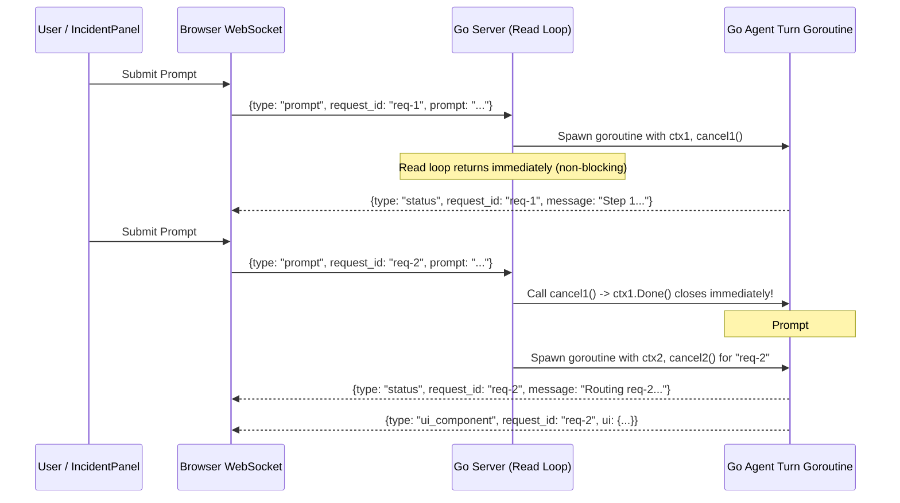

# Implementation Plan: Agent Turn Preemption & In-Flight Panel Cancellation

## Goal Description

Currently, if an agent turn (`MsgTypePrompt`) is slow, stuck, or still streaming when you submit a new prompt to rewrite the panel (or close the panel), the previous agent turn continues running to completion before the new prompt starts, and can overwrite the panel with stale output.

### Root Cause Analysis
1. **Synchronous WebSocket Read Loop Blocking ([`pkg/orchestrator/server.go`](file:///usr/local/google/home/garisingh/projects/ephemeris-live-gke/pkg/orchestrator/server.go#L217-L233)):**
   - `handleWebSocket` invokes `s.handleClientMessage(ctx, conn, state, &clientMsg)` synchronously on the `conn.ReadMessage()` goroutine.
   - Because `MsgTypePrompt` runs `ResolveIntent` $\rightarrow$ `QueryLogs` $\rightarrow$ `GenerateStreamWithIntent` (`mast` ADK agent + Vertex AI + MCP tool calls), `conn.ReadMessage()` is blocked for the entire 15–45s turn. Any new prompt or cancel request sent by the browser sits in the TCP socket buffer until the previous turn finishes.
2. **No `context.CancelFunc` Preemption or `RequestID` Correlation:**
   - `clientState` does not store a `context.CancelFunc` for the active agent turn, nor does `ServerMessage` tag `status` and `ui_component` events with a `request_id`.
3. **No UI Stop Button or Close (`×`) Cancellation Hook ([`web/src/sandbox/panel.js`](file:///usr/local/google/home/garisingh/projects/ephemeris-live-gke/web/src/sandbox/panel.js#L319-L386)):**
   - While a panel is in `STREAMING` state, there is no `⏹ Stop Agent` button to abort the turn in place, and closing (`×`) a streaming panel does not cancel the backend goroutine (causing the closed panel to pop back open when `ui_component` eventually arrives).

---

## Proposed Architecture



---

## Proposed Changes

### 1. WebSocket Protocol (`pkg/api/types.go`)
#### [MODIFY] [types.go](file:///usr/local/google/home/garisingh/projects/ephemeris-live-gke/pkg/api/types.go)
- Add `MsgTypeCancel ClientMessageType = "cancel"` to `ClientMessageType`.
- Add `RequestID string` (`json:"request_id,omitempty"`) to `ClientMessage`, `ServerMessage`, and `UIComponentData` so every status update and compiled UI payload is strictly correlated with the originating prompt turn.

---

### 2. Non-Blocking Agent Turn Goroutines & Context Preemption (`pkg/orchestrator/server.go`)
#### [MODIFY] [server.go](file:///usr/local/google/home/garisingh/projects/ephemeris-live-gke/pkg/orchestrator/server.go)
- Extend `clientState` with:
  ```go
  type clientState struct {
      writeMu         sync.Mutex
      promptMu        sync.Mutex
      activeCancel    context.CancelFunc
      activeRequestID string
      activeResource  string
      selectedNodeID  string
  }
  ```
- Add helper `state.cancelActivePrompt()` (also called automatically when the WebSocket connection closes).
- Handle `api.MsgTypeCancel`:
  - Cancels `state.activeCancel` immediately and sends a status update: `"⏹ Agent synthesis cancelled"`.
- Refactor `api.MsgTypePrompt` into `go s.runPromptTurn(promptCtx, cancel, conn, state, *msg, reqID)`:
  - Cancels any prior in-flight `state.activeCancel()` before launching the new turn goroutine.
  - Inside `runPromptTurn`, `statusFn` checks `if promptCtx.Err() != nil { return }` and tags every `MsgTypeStatus` and `MsgTypeUIComponent` with `RequestID: reqID`.
  - If `promptCtx.Err() != nil` (`context.Canceled`), `runPromptTurn` exits silently without sending `MsgTypeError` or `MsgTypeUIComponent`.

---

### 3. Frontend Cancellation, `RequestID` Filtering & `⏹ Stop Agent` Button
#### [MODIFY] [client.js](file:///usr/local/google/home/garisingh/projects/ephemeris-live-gke/web/src/ws/client.js)
- Update `sendPrompt(selectedNodeId, resourceUri, promptText, requestId)` to generate/pass `request_id` and return it.
- Add `sendCancel(requestId = '')` to send `{ type: 'cancel', request_id: requestId }`.
- Pass the full message (`msg.request_id`) to `onStatus(msg.message, msg.request_id)` and `onUIComponent(msg.ui, msg.request_id)`.

#### [MODIFY] [panel.js](file:///usr/local/google/home/garisingh/projects/ephemeris-live-gke/web/src/sandbox/panel.js)
- Track `this.isGenerating` and `this.activeRequestId` on each `IncidentPanel` instance.
- In `startGeneration(title, initialMessage, requestId)`:
  - If `this.isGenerating` is already true on the target unpinned window, invoke `this.onCancelGeneration?.(this.activeRequestId)` to preempt the prior turn.
  - Render an interactive **`⏹ Stop`** button (`#panel-cancel-gen-btn`) inside the live synthesis stepper header so the user can cancel a slow or unwanted turn with one click.
- Add `cancelGeneration()`:
  - Stops the TTI timer, sets `this.isGenerating = false`, updates badge to `CANCELLED`, and renders a clean recovery prompt box inside the panel.
- Update `hide()` (`×` Close button):
  - If `this.isGenerating` is true when the user closes the panel, automatically call `this.cancelGeneration()` and notify the backend via `onCancelGeneration` so the closed panel never pops back open later.

#### [MODIFY] [main.js](file:///usr/local/google/home/garisingh/projects/ephemeris-live-gke/web/src/main.js)
- Wire `panel.onCancelGeneration = (reqId) => { ws.sendCancel(reqId); hud.setStatusMessage('⏹ Agent turn cancelled.', false); }`.
- In `ws.onStatus` and `ws.onUIComponent`: ignore any incoming message whose `request_id` belongs to a cancelled or superseded turn.

---

## Verification Plan
1. **Unit Tests (`pkg/orchestrator/server_test.go` & `web/src/main.test.js`):**
   - Test that sending a second `MsgTypePrompt` (or `MsgTypeCancel`) over WebSocket while a slow prompt is running immediately cancels the first turn's `context.Context` and only delivers `MsgTypeUIComponent` for the second prompt.
   - Test clicking `#panel-cancel-gen-btn` (`⏹ Stop`) and rewriting a streaming panel in `web/src/main.test.js`.
2. **Full CI Presubmit (`dev/tools/ci`):**
   - Run `dev/tools/ci` and restart the live server on `:8080`.
