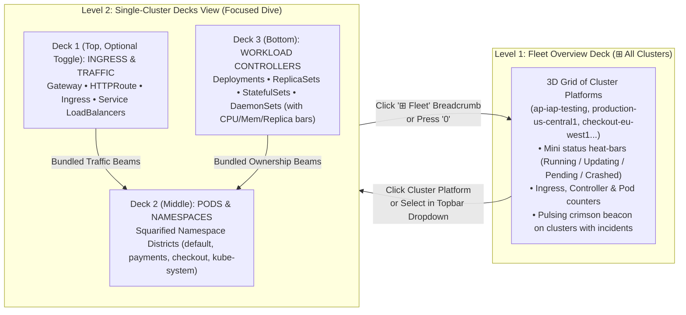

# Ephemeris "Decks" Layout: Visual Mockup, 3-Deck Ingress Toggle, Themes & Multi-Cluster Mock Engine

## 1. Visual Mockup: `ephemeris decks` vs `substrate-scope`

Instead of stacking all 6 Kubernetes resource tiers vertically over every single pod on one crowded plane, the **Decks** layout separates **Ingress & Routing**, **Workload Execution (Pods by Namespace District)**, and **Controllers (Deployments, ReplicaSets, StatefulSets)** onto translucent, interactive 3D decks connected by bundled cubic-bezier focus beams and flow ribbons.

````carousel

<!-- slide -->

<!-- slide -->

````

---

## 2. Multi-Cluster Representation: "Fleet Overview Deck" ↔ "Cluster Dive"

In `substrate-scope`, each cluster gets its own dedicated view because merging many clusters into one 3D island creates visual clutter. For **Ephemeris**, we use a **Two-Level Fleet ↔ Cluster Dive** model:



### How Multi-Cluster Navigation Works:
1. **Level 1 — Fleet Overview Deck (`⊞ Fleet` button in `#topbar` or key `0`):**
   - Renders a single 3D **Fleet Deck** where each GKE cluster is a framed **Cluster Platform** arranged in a squarified grid (sorted with active incidents/workloads up front).
   - Each Cluster Platform shows:
     - **Cluster Name & Location Badge** (e.g., `ap-iap-testing · us-central1`, `production-us-central1 · us-central1-a`).
     - **3D Pod Status Pillars / Heat-Tiles:** Proportional 3D bars inside the cluster card showing `Running` (teal), `Updating` (purple), `Pending` (amber), and `Crashed` (pulsing red).
     - **Resource Summary Strip:** Counts of `Ingresses`, `Controllers`, and `Pods`, plus an active incident beacon if any pod is in `CrashLoopBackOff` / `OOMKilled`.
   - **Click to Dive:** Clicking any Cluster Platform smoothly flies the camera into **Level 2 (Single-Cluster Decks View)** for that cluster.
2. **Level 2 — Single-Cluster Decks View (`⊞ Fleet › ap-iap-testing ▾`):**
   - Dedicated 100% to the selected cluster so its Namespace Districts, Pods, Controllers, and Ingresses have maximum breathing room.
   - **Quick Cluster Switcher in `#topbar`:** Clicking the cluster name dropdown (`ap-iap-testing ▾`) lists all clusters with status LEDs (`● 2 crashed`, `● 24 running`, `○ 0 pods`) so you can jump directly from one cluster's decks to another in 1 click without returning to the Fleet Overview first.

---

## 3. The 3-Deck Ingress Toggle (`2-deck | 3-deck | combined`)

Within any cluster view, the topbar `#layout` segmented control and `#ing-deck` toggle let you switch between:

| Mode | Decks Rendered | Best For |
| :--- | :--- | :--- |
| **`2-deck` (Default)** | **Top Deck (`Pods & Namespaces`)** + Gateway Portal ring at back corner<br>**Bottom Deck (`Controllers & Services`)** | Fast everyday workload & replica inspection |
| **`3-deck` (`+ Ingress Deck`)** | **Deck 1 — Top (`y = +gap`, `Ingress & Routing`):** `Gateway`, `HTTPRoute`, `Ingress`, and `Service` load-balancer pads arranged by route group, with traffic rate & backend health bars<br>**Deck 2 — Middle (`y = 0`, `Pods & Namespaces`):** Squarified Namespace Districts holding all `Pods`<br>**Deck 3 — Bottom (`y = -gap`, `Workload Controllers`):** `Deployment`, `ReplicaSet`, `StatefulSet`, and `DaemonSet` pads with replica readiness (`3/3`), CPU, and memory fill bars | End-to-end North-South & East-West incident triage (`Gateway -> HTTPRoute -> Service -> Pod <- Deployment`) |
| **`combined` (1-Island)** | Single horizontal island with Namespace Districts in the center, Controller pads along the front edge, and Ingress portals along the back edge | Side-by-side flat overview |

### Cross-Deck Beams & Solo Controls in `3-deck` Mode:
- **Top-to-Middle Beams (Ingress → Pods):** Hovering or selecting a `Gateway`, `HTTPRoute`, `Ingress`, or `Service` on **Deck 1 (Top)** shoots glowing cyan/violet **Traffic Beams** downward into the matching `Pods` on **Deck 2 (Middle)**.
- **Bottom-to-Middle Beams (Controllers → Pods):** Hovering or selecting a `Deployment`, `ReplicaSet`, or `StatefulSet` on **Deck 3 (Bottom)** shoots bundled **Ownership Beams** upward into its managed `Pods` on **Deck 2 (Middle)**.
- **Pod Selection (Full Vertical Trace):** Clicking a `Pod` on the Middle Deck simultaneously illuminates its **upstream Ingress/Service route** on the Top Deck AND its **owning Deployment/ReplicaSet** on the Bottom Deck!
- **Solo Any Deck (`1`, `2`, `3`, `4`):**
  - `1`: Solo **Ingress & Routing** deck (fades Pods & Controllers to 15% opacity).
  - `2`: Solo **Pods & Namespaces** deck.
  - `3`: Solo **Workload Controllers** deck.
  - `4` (or press active key again): Show **All Decks**.
- **Movable & Linkable Decks:**
  - Drag any deck's glowing rim (`Alt+Drag` or rim drag) to slide it horizontally out from under/above the other decks for an unobstructed view, or `Shift+Drag` to expand the vertical spacing between all decks.

---

## 4. Same Themes as `substrate-scope` (Dark + Light Themes)

We port the exact theme engine (`THEMES`, `cssVars`, `ThemePicker` with 4-color swatches and `?theme=<id>` URL persistence) from `substrate-scope/web/js/themes.js` and `theming.js`, supporting both **Dark** and **Light** modes out of the box:

- **Dark Themes:**
  - **`Abyss Neon` (`dark`, default):** Deep ocean navy (`#07111f`), neon teal running states (`#0fa395`), electric violet transitions (`#8f7bff`), crimson crash alerts (`#ec3d5a`).
  - **`Orchid Night` (`dark`):** Deep violet space (`#140b22`), orchid pink grid/accents (`#ff7ac8`), purple running states (`#9a6cf2`).
  - **`Volt Noir` (`dark`):** High-contrast obsidian (`#0c0c0f`) with acid volt-green rims (`#c6ff3d`).
  - **`Google Dark` (`dark`):** Material Dark elevation (`#202124` / `#303134`) with Gemini Aurora brand accents (`#8ab4f8`, `#a770ef`, `#34a853`).
- **Light Themes:**
  - **`Google Light` (`light`):** Clean Material Light (`#f8f9fa` / `#ffffff`) with Google green (`#188038`), blue (`#1a73e8`), red (`#d93025`), and Gemini Aurora selection borders.
  - **`Glacier` (`light`):** Crisp alpine ice-blue (`#eef4fb` / `#ffffff`) with cobalt running states (`#0062e6`) and royal violet accents (`#7c3aed`).
  - **`Cotton Candy` (`light`)** & **`Riso Paper` (`light`)**: Full parity with `substrate-scope`'s light palette.

---

## 5. Standalone Mock & Synthetic Data Engine (Round 1 Interface Focus)

Just like `substrate-scope`, `/decks` works **100% standalone in the browser with rich mock & synthetic data** (while also accepting live `/ws` topology updates when connected):

1. **Multi-Cluster Mock Fleet (`6` realistic GKE clusters out of the box):**
   - `ap-iap-testing` (`us-central1`, active IAP Gateway + `store-v1` + `payment-service` CrashLoopBackOff incident)
   - `production-us-central1` (`us-central1-a`, core e-commerce microservices across `default`, `payments`, `checkout`, `shipping`, `kube-system`)
   - `checkout-eu-west1` (`eu-west1-b`, regional EU checkout & Redis cart cluster)
   - `ai-inference-gpu` (`us-east4-c`, L4/A100 GPU model serving workloads)
   - `analytics-us-east1` (`us-east1-b`, streaming ingest & StatefulSet workers)
   - `staging-asia-east1` (`asia-east1-a`, canary rollout in progress)
2. **Interactive Scenario & Scale Switcher in `#topbar` (and URL params `?scenario=...&synthetic=N`):**
   - `Default Incident (CrashLoop + OOM)`
   - `Redis OOM Cascade`
   - `Gateway 5xx Traffic Spike`
   - `Canary Rollout Wave`
   - `All Healthy`
   - `Synthetic Scale: 120 Pods` / `Synthetic Scale: 300 Pods`
3. **Live Simulated Kubernetes Event Stream (`#feedpanel`):**
   - Continuous or pauseable simulated K8s events (`CrashLoopBackOff`, `OOMKilled`, `ScaledUp`, `HTTPRouteAttached`, `PodReady`) in the collapsible left panel; clicking any event flies the camera directly to that Pod or Controller.
4. **Cross-Deck Inspector Panel (`#panel`):**
   - Clicking any **Pod**, **Controller**, or **Ingress/Gateway/Service** slides in the right-hand inspector with status badges, replica/CPU/memory bars, clickable cross-deck jump chips (`Show Ingress`, `Show Controller`, `Show Pods`), container logs, YAML manifest snippet, and a 1-click **`🛠️ Remediate / Restart`** button that heals crashing pods in the mock state and emits a `RemediationComplete` event.
