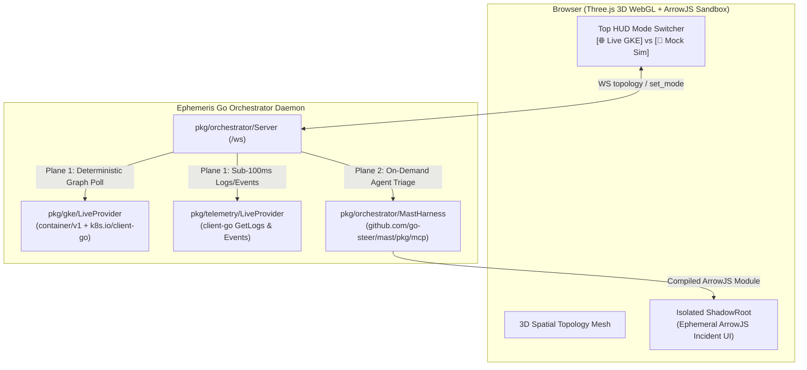

# Two-Plane Live GKE Multi-Cluster Architecture

## 1. Overview

`ephemeris` separates live Google Kubernetes Engine (GKE) observability into two distinct architectural planes:

1. **Deterministic Spatial Canvas & Telemetry Plane (`pkg/gke/live.go`, `pkg/telemetry/live.go`):**
   - Powered by the **Native Google Cloud GKE Go SDK (`google.golang.org/api/container/v1`)** and the **Native Kubernetes Go Client (`k8s.io/client-go/kubernetes`)**.
   - Discovers all running GKE clusters in the target GCP project (`projects/<project>/locations/-`) and builds in-memory `k8s.io/client-go` `rest.Config` instances from each cluster's `Endpoint`, `MasterAuth.ClusterCaCertificate`, and Application Default Credentials (`oauth2.TokenSource`).
   - Concurrently queries typed `Pod`, `Deployment`, `ReplicaSet`, `StatefulSet`, `DaemonSet`, and `Service` lists across all clusters to reconstruct 100% authentic `metadata.ownerReferences` (`UID -> UID`) and `Service.Spec.Selector` edges for the 60fps Three.js 3D WebGL scene.

2. **Agentic Incident Triage Plane (`pkg/mcp/client.go`, `pkg/orchestrator/mast_harness.go`, `pkg/orchestrator/agent.go`):**
   - Powered by **[`github.com/go-steer/mast/pkg/mcp`](https://github.com/go-steer/mast) (`v0.9.0`)** (`mcp.NewGKEToolset` for `https://container.googleapis.com/mcp` and `mcp.NewToolset` for `https://logging.googleapis.com/mcp`).
   - Enforces a strict read-only `tool.StringPredicate` (`mutating: false`) matching `mast`'s `gke-triage` workload catalog (`list_clusters`, `get_cluster`, `get_k8s_resource`, `describe_k8s_resource`, `list_k8s_events`, `get_k8s_logs`, `get_k8s_rollout_status`, `list_log_entries`).
   - Invoked on-demand when an SRE clicks a 3D node or submits a natural-language incident prompt to Gemini (`gemini-3.8-flash`).

