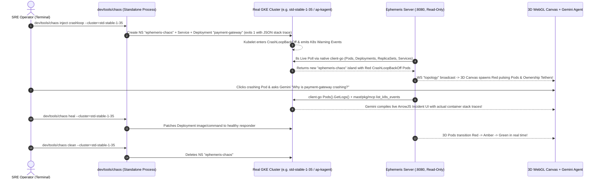

# Plan: Standalone Live GKE Chaos Simulator (`dev/tools/chaos`)

## 1. Goal & Why It Lives Outside the Main Module

To keep `ephemeris` (`cmd/ephemeris` and `pkg/...`) strictly **read-only** by design while allowing us to test and demo real incidents on our live GKE clusters (`gke-demos-345619`), we will build a **standalone Live GKE Chaos Simulator process**:

- **Entrypoint:** [`dev/tools/chaos`](file:///usr/local/google/home/garisingh/projects/ephemeris-live-gke/dev/tools/chaos) (CLI wrapper script)
- **Isolated Go Module:** `dev/chaos/go.mod` & `dev/chaos/main.go` (completely separate Go module from root `go.mod`, so zero write/mutation code ever enters the `ephemeris` binary or CI bundle).
- **Real-Time Live Canvas Auto-Sync:** We will also add an **8-second live topology broadcast ticker** (`cacheTTL: 6s`) to `pkg/orchestrator/server.go` when `mode == "live"`, so any fault injected or healed by `dev/tools/chaos` in a separate terminal automatically animates on the 3D WebGL canvas within seconds!

---

## 2. Safety Guardrails for Real GKE Clusters

> [!IMPORTANT]
> **Strict `ephemeris-chaos` Namespace Sandbox:**
> 1. Every Kubernetes object created by `dev/tools/chaos` is strictly confined to a dedicated **`ephemeris-chaos`** namespace and labeled `app.kubernetes.io/managed-by=ephemeris-chaos`.
> 2. The simulator refuses to modify or delete any resource outside `ephemeris-chaos`.
> 3. Running `dev/tools/chaos clean` deletes the `ephemeris-chaos` namespace across target clusters in one command, leaving the clusters 100% clean.
> 4. Tiny CPU/Memory footprints (`10m` CPU, `16Mi` RAM using `registry.k8s.io/busybox` / `registry.k8s.io/pause`) ensure zero impact on cluster node capacity.

---

## 3. Architecture & End-to-End Flow



---

## 4. Supported CLI Commands & Chaos Scenarios (`dev/tools/chaos`)

```bash
# 1. Inject a realistic microservice CrashLoopBackOff + Redis StatefulSet topology
dev/tools/chaos inject crashloop --cluster=std-stable-1-35

# 2. Inject an OOMKilled (Exit 137) + ImagePullBackOff cascade across multiple clusters
dev/tools/chaos inject oom-cascade --cluster=std-stable-1-35,ap-kagent

# 3. Inject unschedulable Pending pods (FailedScheduling: Insufficient cpu/memory)
dev/tools/chaos inject pending-quota --cluster=std-stable-1-35

# 4. Heal all deployments in ephemeris-chaos (triggers a real GKE rolling update to Running)
dev/tools/chaos heal --cluster=std-stable-1-35

# 5. Check live status of ephemeris-chaos workloads across clusters
dev/tools/chaos status --cluster=std-stable-1-35

# 6. Teardown and delete the ephemeris-chaos namespace completely
dev/tools/chaos clean --cluster=std-stable-1-35
```

### What Each Scenario Creates in `ephemeris-chaos`

| Scenario | Real K8s Objects Created | Real Logs & Events Generated on GKE |
| :--- | :--- | :--- |
| **`crashloop`** | `Service/payment-gateway`, `Deployment/payment-gateway` (2 replicas), `StatefulSet/redis-ledger` (1 healthy replica) | Emits structured JSON `FATAL` panic stack traces (`redis connection pool exhausted: dial tcp redis-ledger:6379: i/o timeout`) to container `stderr` and exits `1`, triggering real `CrashLoopBackOff` & `BackOff` K8s events. |
| **`oom-cascade`** | `StatefulSet/redis-cache` (exits `137` simulating `OOMKilled`), `Deployment/checkout-worker` (`ImagePullBackOff`), `Deployment/frontend-web` (`Running`) | Mixed green/red/amber multi-tier topology (`Service -> Deployment -> ReplicaSet -> Pod`) with real `BackOff` and `ErrImagePull` events. |
| **`pending-quota`** | `Deployment/llm-batch-trainer` (2 replicas requesting `128` CPU cores & `512Gi` RAM per pod) | Real GKE scheduler marks pods `Pending` and emits `FailedScheduling: Insufficient cpu, Insufficient memory` Warning events. |
| **`heal`** | Patches `Deployment/payment-gateway` and `StatefulSet/redis-cache` container commands to a healthy heartbeat loop | Real Kubernetes rolling update (`ReplicaSet` scale-up/scale-down) visible live on the 3D WebGL canvas as pods turn green. |

---

## 5. Proposed Changes

### 1. Standalone Chaos Simulator (`dev/chaos/` & `dev/tools/chaos`)

#### [NEW] `dev/chaos/go.mod` & `dev/chaos/main.go`
- Standalone Go module (`github.com/go-steer/ephemeris/dev/chaos`) that connects to any cluster in `gke-demos-345619` using `google.golang.org/api/container/v1` + `k8s.io/client-go/kubernetes` via ADC (no `kubectl` or kubeconfig required).
- Implements `inject` (`crashloop`, `oom-cascade`, `pending-quota`), `heal`, `status`, and `clean` strictly scoped to the `ephemeris-chaos` namespace.

#### [NEW] `dev/tools/chaos`
- Executable shell wrapper (`chmod +x dev/tools/chaos`) that runs `go -C dev/chaos run . "$@"` so you can invoke `dev/tools/chaos ...` directly from the repo root.

---

### 2. Real-Time Live Topology Push in Ephemeris (`pkg/orchestrator/server.go` & `pkg/gke/live.go`)

#### [MODIFY] [live.go](file:///usr/local/google/home/garisingh/projects/ephemeris-live-gke/pkg/gke/live.go) & [server.go](file:///usr/local/google/home/garisingh/projects/ephemeris-live-gke/pkg/orchestrator/server.go)
- Reduce `LiveProvider.cacheTTL` to `6 * time.Second` and add a background `8 * time.Second` ticker in `Server` that refreshes and broadcasts `MsgTypeTopology` whenever `s.mode == "live"` and at least one browser client is connected.
- That way, running `dev/tools/chaos inject crashloop` or `dev/tools/chaos heal` in your terminal updates the 3D WebGL canvas automatically without needing to refresh the page!

---

## 6. Verification Plan

1. Run `dev/tools/ci` to verify the main module and CI presubmits remain 100% green.
2. Run `dev/tools/chaos inject crashloop --cluster=std-stable-1-35` against the real `std-stable-1-35` GKE cluster in `gke-demos-345619`.
3. Verify that `ephemeris` (`http://localhost:8080`) automatically detects the new `ephemeris-chaos` namespace and crashing `payment-gateway` pods on `std-stable-1-35`, streams the real container panic logs via `client-go`, and then heals/cleans up cleanly via `dev/tools/chaos heal` and `dev/tools/chaos clean`.
