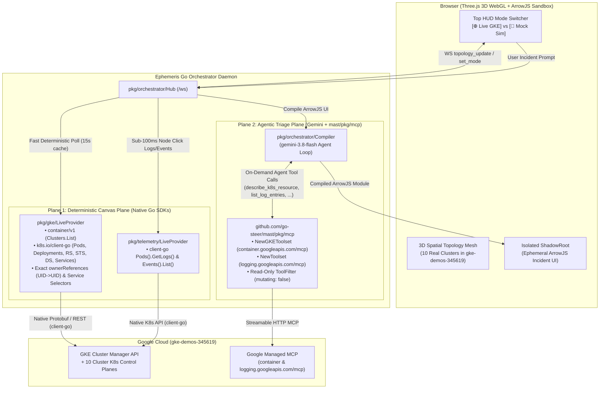

# Plan: Live GKE Multi-Cluster Architecture — Native Go Clients for the 3D Canvas + `mast/pkg/mcp` for the Agent

## 1. Architectural Separation: Deterministic Canvas Plane vs. Agentic Triage Plane

Your intuition is spot-on. Using MCP to continuously poll cluster state for a 60fps 3D WebGL canvas was the wrong tool for that layer:

| Plane | Frequency & Consumer | Why MCP Is Wrong Here / Right Here | Right Technology Stack |
| :--- | :--- | :--- | :--- |
| **1. Spatial Canvas & Telemetry Plane** (`pkg/gke`, `pkg/telemetry`) | **Continuous / High-Frequency** (Every 5–15s background sync + instant click telemetry, consumed deterministically by Three.js) | **Wrong place for MCP:** MCP wraps outputs in LLM-oriented text blocks, either dumping 3.2 MB of stringified JSON per cluster or `kubectl -o wide` text tables that strip `metadata.uid`, `metadata.ownerReferences`, and `spec.selector`. | **Native Google Cloud Go SDK (`google.golang.org/api/container/v1`) + Kubernetes Go Client (`k8s.io/client-go`)** authenticated in-memory via ADC (`google.DefaultTokenSource`) + cluster `MasterAuth.ClusterCaCertificate`. |
| **2. Agentic Incident Triage Plane** (`pkg/orchestrator/compiler.go`) | **On-Demand / Event-Driven** (Only when the SRE clicks a resource or asks a natural-language triage question to Gemini) | **Exact right place for MCP:** The LLM agent needs self-describing schemas and targeted deep-inspection tools (`describe_k8s_resource`, `list_k8s_events`, `get_k8s_logs`, `get_k8s_rollout_status`, `list_log_entries`) to investigate the specific anomaly before compiling the ArrowJS UI. | **`github.com/go-steer/mast/pkg/mcp` (`v0.9.0`)** (`mcp.NewGKEToolset` + `mcp.NewToolset("logging")` with `ToolFilter` enforcing `mutating: false`). |

---

## 2. Two-Plane Live GKE Architecture

---

## 3. Why Native `container/v1` + `k8s.io/client-go` Transforms the 3D Canvas

By using `google.golang.org/api/container/v1` + `k8s.io/client-go/kubernetes` for `pkg/gke/live.go`:
1. **Zero `kubeconfig` / Zero `gcloud` Exec Overhead:**
   - `container/v1` returns each cluster's `Endpoint` and base64 `MasterAuth.ClusterCaCertificate`.
   - We build a `*rest.Config` directly in Go memory for each of the 10 clusters using the shared ADC `oauth2.TokenSource` (`https://www.googleapis.com/auth/cloud-platform`), so `k8s.io/client-go` talks directly to all 10 GKE API servers concurrently in **~200ms**.
2. **100% Authentic Kubernetes Ownership Graph (`ownerReferences` + Label Selectors):**
   - Unlike `kubectl -o wide` text tables over MCP, `k8s.io/client-go` gives us typed `v1.Pod`, `appsv1.Deployment`, `appsv1.ReplicaSet`, `appsv1.StatefulSet`, `appsv1.DaemonSet`, `v1.Service`, and `gatewayv1.HTTPRoute`/`Gateway` objects with their exact **`metadata.uid`**, **`metadata.ownerReferences`**, and **`spec.selector`**.
   - Every 3D ownership tether (`Deployment -> ReplicaSet -> Pod`, `StatefulSet -> Pod`, `DaemonSet -> Pod`, and `Service -> Pod`) is constructed from the real Kubernetes UIDs and label selectors on your clusters!

---

## 4. Proposed Changes

### 1. Canvas Plane: Native GKE & Kubernetes Go Client (`pkg/gke` & `pkg/telemetry`)

#### [NEW] `pkg/gke/live.go` (replaces `pkg/gke/mcp.go`)
- Uses `google.golang.org/api/container/v1` (`Projects.Locations.Clusters.List("projects/" + projectID + "/locations/-")`) to discover all running GKE clusters in `gke-demos-345619`.
- For each cluster, builds an in-memory `k8s.io/client-go/kubernetes.Clientset` from `cluster.Endpoint`, `cluster.MasterAuth.ClusterCaCertificate`, and the ADC `oauth2.TokenSource` (with a `3.5s` per-cluster timeout).
- Concurrently lists `Pods`, `Deployments`, `ReplicaSets`, `StatefulSets`, `DaemonSets`, and `Services`, mapping exact `metadata.ownerReferences` and `Service.Spec.Selector` labels into `api.TopologyData` (`Clusters`, `Namespaces`, `Pods`, `Resources`, `Links`).
- Caches the multi-cluster snapshot for `15s` so the `5s` WebSocket broadcast loop is instantaneous.

#### [NEW] `pkg/telemetry/live.go` (replaces `pkg/telemetry/mcp.go`)
- Uses the same in-memory `k8s.io/client-go` clientsets to fetch live container logs (`CoreV1().Pods(ns).GetLogs(pod, &v1.PodLogOptions{TailLines: 25})`) and Kubernetes warning/normal events (`CoreV1().Events(ns).List(...)`) in `< 100ms` whenever an operator clicks a 3D resource or submits a prompt.

---

### 2. Agent Plane: `github.com/go-steer/mast/pkg/mcp` in `pkg/orchestrator`

#### [DELETE] `pkg/mcp/client.go` & `pkg/mcp/client_test.go`
- Remove our custom hand-rolled JSON-RPC client completely.

#### [MODIFY] [compiler.go](file:///usr/local/google/home/garisingh/projects/ephemeris/pkg/orchestrator/compiler.go)
- Attach `github.com/go-steer/mast/pkg/mcp` (`mcp.NewGKEToolset` for `container.googleapis.com/mcp` and `mcp.NewToolset` for `logging.googleapis.com/mcp`, filtered with `tool.StringPredicate` to the `mutating: false` tools) to `AgentCompiler`.
- When compiling an incident UI in Live GKE mode, expose the read-only MCP tool declarations (`describe_k8s_resource`, `list_k8s_events`, `get_k8s_logs`, `get_k8s_rollout_status`, `list_log_entries`) to `gemini-3.8-flash` (allowing up to 2 tool-call turns via `mast/pkg/mcp` before emitting the final ArrowJS module).

---

### 3. Live HUD Mode Switcher (`🌐 Live GKE` vs. `🧪 Mock Sim`)

#### [MODIFY] [main.go](file:///usr/local/google/home/garisingh/projects/ephemeris/cmd/ephemeris/main.go), [hub.go](file:///usr/local/google/home/garisingh/projects/ephemeris/pkg/orchestrator/hub.go), & [hud.js](file:///usr/local/google/home/garisingh/projects/ephemeris/web/src/ui/hud.js)
- Wire both `MockProvider` and `LiveProvider` (`gke-demos-345619`) into `orchestrator.Hub` and add a **`🌐 Live GKE (gke-demos-345619)` / `🧪 Mock Sim`** switcher button in the top SRE HUD bar so you can switch between your 10 real GKE clusters and the Mock Chaos Engine anytime without restarting the daemon.

---

## 5. Verification Plan

1. **Automated CI (`dev/tools/ci`):**
   - Run `dev/tools/ci` to verify all Go and Web unit tests, linters, and license checks pass.
2. **Live Multi-Cluster Verification (`gke-demos-345619`):**
   - Switch to **`🌐 Live GKE`** in the top HUD bar and verify that all 10 clusters (`ap-agones`, `ap-ambient-mesh`, `ap-kagent`, `kube-agents-host`, `std-stable-1-35`, etc.) and their real Kubernetes ownership trees (`Deployment -> ReplicaSet -> Pod`, `Service -> Pod`) render on the 3D canvas via `container/v1` + `client-go`, and that clicking a workload + asking Gemini invokes `mast/pkg/mcp` to compile a live incident UI.
