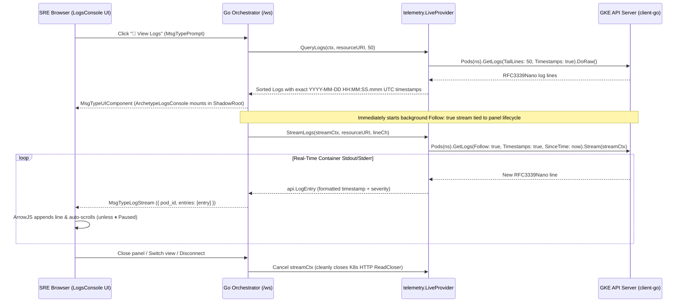

# Plan: Real-Time Pod Log Streaming (`Follow: true`) & Accurate RFC3339 Millisecond Timestamps

## 1. Diagnosis: Answering Your Two Questions

### Q1: Do we actually support streaming the logs right now?
**No — currently, `LogsConsole` is a one-shot snapshot (`TailLines: 50`), not a live continuous stream.**
- When you click **`📜 View Logs`** (or ask `"show me the logs for <pod>"`), [`LiveProvider.QueryLogs`](file:///usr/local/google/home/garisingh/projects/ephemeris-live-gke/pkg/telemetry/live.go#L75-L84) executes a single `DoRaw(ctx)` HTTP request:
  ```go
  rawLogs, err := cs.CoreV1().Pods(namespace).GetLogs(podName, &corev1.PodLogOptions{
      TailLines:  &tailLines,
      Timestamps: true,
  }).DoRaw(logCtx)
  ```
- That static slice of lines is serialized into the ArrowJS `state.logs` array once when the panel mounts.
- Even though the Logs Console header has a **`⏸ Pause Tail` / `▶ Resume Stream`** button (`togglePause()`), it currently only toggles a boolean inside the sandbox (`state.isPaused`)—no subsequent lines are streamed from the Kubernetes API server over the WebSocket.

---

### Q2: Why do the log entries not have accurate timestamps?
We traced the timestamp pipeline across [`pkg/orchestrator/polymorphic.go`](file:///usr/local/google/home/garisingh/projects/ephemeris-live-gke/pkg/orchestrator/polymorphic.go#L250-L254) and [`pkg/telemetry/live.go`](file:///usr/local/google/home/garisingh/projects/ephemeris-live-gke/pkg/telemetry/live.go#L98-L111) and found **three bugs**:

1. **Hardcoded `".000"` Milliseconds & Stripped Dates in `synthesizeLogsConsoleUI` (`pkg/orchestrator/polymorphic.go:251-254`):**
   ```go
   for _, entry := range telemetry.Logs {
       ts := entry.Timestamp
       if len(ts) >= 19 {
           ts = ts[11:19] + ".000" // <-- BUG: Strips YYYY-MM-DD and real milliseconds, hardcodes ".000"!
       }
   ```
   Even though Kubernetes `GetLogs(..., Timestamps: true)` returns nanosecond-precision RFC3339 timestamps (`2026-09-20T10:10:56.819274112Z`), `synthesizeLogsConsoleUI` slices characters `11:19` (`10:10:56`), discards the real `.819` milliseconds and date, and appends a literal `".000"` to every single log line.
2. **K8s Event `FirstTimestamp` Missing Fallback (`pkg/telemetry/live.go:98-104`):**
   When appending Kubernetes `Events(namespace).List` items, the code checks `ev.LastTimestamp` and `ev.EventTime`, but **omits `ev.FirstTimestamp` and `ev.CreationTimestamp`**. For standard Kubernetes v1 events where only `FirstTimestamp` or `CreationTimestamp` is populated, `ts.IsZero()` evaluates to true and stamps old historical events with `time.Now().UTC()`!
3. **Unsorted Merged Log & Event Timeline:**
   `QueryLogs` appends container stdout lines first and Kubernetes events at the end without sorting them chronologically by parsed `time.Time`, causing out-of-order timestamps in the console.

---

## 2. Proposed Architecture



---

## 3. Step-by-Step Implementation Plan

### Step 1: Accurate Timestamp Parsing, Formatting & Chronological Sorting (`pkg/telemetry/live.go` & `pkg/orchestrator/polymorphic.go`)
- **Add `formatLogTimestamp(raw string) (formatted string, parsed time.Time)` in `pkg/telemetry/live.go`:**
  - Parse `time.RFC3339Nano` and `time.RFC3339` timestamps returned by kubelet (`2026-09-20T10:10:56.819274112Z`).
  - Format with true millisecond precision and date: `2006-01-02 15:04:05.000 UTC` (e.g., `2026-09-20 10:10:56.819 UTC`).
  - For Kubernetes `Events`, inspect `ev.LastTimestamp`, `ev.EventTime`, `ev.Series.LastObservedTime`, `ev.FirstTimestamp`, and `ev.CreationTimestamp` in priority order so historical events always retain their authentic cluster timestamp.
  - Sort all combined log entries chronologically (`Oldest -> Newest`) before returning from `QueryLogs`.
- **Fix `synthesizeLogsConsoleUI` (`pkg/orchestrator/polymorphic.go`):**
  - Remove the broken `ts = ts[11:19] + ".000"` truncation.
  - Preserve the exact millisecond-accurate timestamp from `entry.Timestamp` (and format cleanly if raw RFC3339 is passed).

### Step 2: Real-Time `Follow: true` Log Streaming (`pkg/telemetry/` & `pkg/api/types.go`)
- **Protocol (`pkg/api/types.go`):**
  - Add `MsgTypeLogStream = "log_stream"` (`ServerMessage.LogStream *LogStreamData` with `PodID`, `ResourceURI`, and `Entries []LogEntry`).
  - Add `MsgTypeStopLogStream = "stop_log_stream"` so the client can explicitly stop streaming when the panel is closed.
- **`Streamer` Interface & `LiveProvider.StreamLogs` (`pkg/telemetry/live.go`):**
  - Implement `StreamLogs(ctx context.Context, resourceURI string, out chan<- api.LogEntry) error`:
    - Resolve `(clusterName, namespace, podName)` from `resourceURI`.
    - Open a live streaming connection via `k8s.io/client-go`:
      ```go
      since := metav1.NewTime(time.Now().UTC())
      stream, err := cs.CoreV1().Pods(namespace).GetLogs(podName, &corev1.PodLogOptions{
          Follow:     true,
          Timestamps: true,
          SinceTime:  &since,
      }).Stream(ctx)
      ```
    - Scan lines in real time using `bufio.Scanner`, parse each line's `RFC3339Nano` timestamp and severity (`parseRawLogLines`), and push to `out` until `ctx.Done()` or EOF.
  - Implement `MockProvider.StreamLogs` (`pkg/telemetry/mock.go`) with a `2s` ticker emitting realistic live container tail entries so mock mode also streams live.

### Step 3: Per-Client Stream Lifecycle & Reactive ArrowJS Console (`pkg/orchestrator/server.go`, `web/src/ws/client.js`, `web/src/main.js`, `pkg/orchestrator/polymorphic.go`)
- **Orchestrator Lifecycle (`pkg/orchestrator/server.go`):**
  - Add `logStreamCancel context.CancelFunc` to `clientState`.
  - When a prompt turn finishes with `ArchetypeLogsConsole`, start `go s.runLogStream(streamCtx, conn, state, resourceURI, podName)`.
  - Cancel any active log stream automatically when:
    1. A new `MsgTypePrompt` turn starts for a different view,
    2. The user closes the panel (`MsgTypeStopLogStream` / `MsgTypeCancel`), or
    3. The WebSocket disconnects.
- **ArrowJS Reactive Tail & Auto-Scroll (`pkg/orchestrator/polymorphic.go`, `web/src/main.js`):**
  - Wire `ws.onLogStream` in `web/src/ws/client.js` and `web/src/main.js` to dispatch `window.dispatchEvent(new CustomEvent('ephemeris-log-stream', { detail: data }))`.
  - Update `synthesizeLogsConsoleUI` so the ArrowJS template listens to `ephemeris-log-stream`, appends incoming lines into `state.logs` (when `!state.isPaused`, buffering while paused), displays a pulsing **`🟢 LIVE TAILING`** status badge with streamed line count, and auto-scrolls the log viewport to the newest entry.

---

## 4. Verification Plan
1. Run `dev/tools/ci` to verify unit tests, race detector, and linters pass.
2. Rebuild and restart the live daemon on `:8080` (`ap-iap-testing` / `gke-demos-345619`).
3. Click **`📜 View Logs`** on a live pod and verify:
   - Every log entry shows its exact `YYYY-MM-DD HH:MM:SS.mmm UTC` timestamp (no `.000` truncation).
   - The **`🟢 LIVE TAILING`** indicator is active and new container requests/probes stream into the console in real time without re-running the prompt.
   - Clicking **`⏸ Pause Tail`** freezes the viewport (counting buffered lines) and **`▶ Resume Stream`** flushes them immediately.
